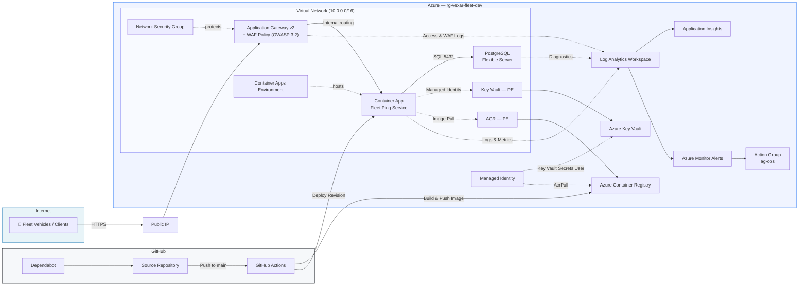

# Architecture — VexarDrive Fleet Ping Service

## Azure Architecture Diagram

## Component Summary

| Component | Azure Service | Purpose |
|---|---|---|
| **Ingress / WAF** | Application Gateway v2 + WAF Policy | TLS termination, OWASP 3.2 protection, HTTP→HTTPS redirect |
| **Network Security** | Network Security Group | Restricts inbound traffic on the `snet-appgw` subnet to 80/443/GatewayManager |
| **Compute Environment** | Container Apps Environment (Internal) | VNet-integrated hosting environment for the Container App |
| **Compute** | Container App | Runs the Fleet Ping Service, auto-scales on HTTP load |
| **Database** | PostgreSQL Flexible Server | Persistent storage for fleet pings and driver data |
| **Secrets** | Azure Key Vault (+ Private Endpoint) | Stores DB password, JWT secret — accessed via Managed Identity over a private endpoint |
| **Container Registry** | Azure Container Registry, Premium (+ Private Endpoint) | Private Docker image storage, pulled over a private endpoint |
| **Identity** | Managed Identity (User-Assigned) | Grants the Container App least-privilege RBAC access to Key Vault and ACR — no stored credentials |
| **Monitoring** | Log Analytics + Application Insights | Centralized logging, metrics, and tracing |
| **Alerting** | Azure Monitor Alerts + Action Group | Fires on 5xx rate, DB CPU/storage/connections, WAF blocks; notifies `ops@vexardrive.com` |
| **CI/CD** | GitHub Actions | Automated test → scan → build → deploy pipeline |
| **Dependency Mgmt** | Dependabot | Automated PRs for npm, Actions, and Terraform updates |

## Network Boundaries

| Component | Public? | Access Method |
|---|---|---|
| Application Gateway | ✅ Yes | Public IP — only entry point, protected by NSG + WAF |
| Container Apps Environment / Container App | ❌ No | Internal Load Balancer, reachable only within the VNet |
| PostgreSQL | ❌ No | Delegated subnet, no public endpoint |
| Key Vault | ❌ No | Private endpoint only (`snet-pe`) |
| ACR | ❌ No | Private endpoint only (`snet-pe`) |

## Data Flow

1. **Fleet vehicles** send location pings over HTTPS to the Application Gateway public IP.
2. **WAF** inspects the request (blocks SQL injection, XSS, bot attacks).
3. **Application Gateway** routes clean traffic to the internal Container App.
4. **Container App** validates the request, inserts data into **PostgreSQL** via connection pool.
5. **Secrets** (DB password, JWT key) are fetched from **Key Vault** at container startup using **Managed Identity**.
6. **Logs** flow from all components to **Log Analytics**; **alerts** fire on anomalies.
